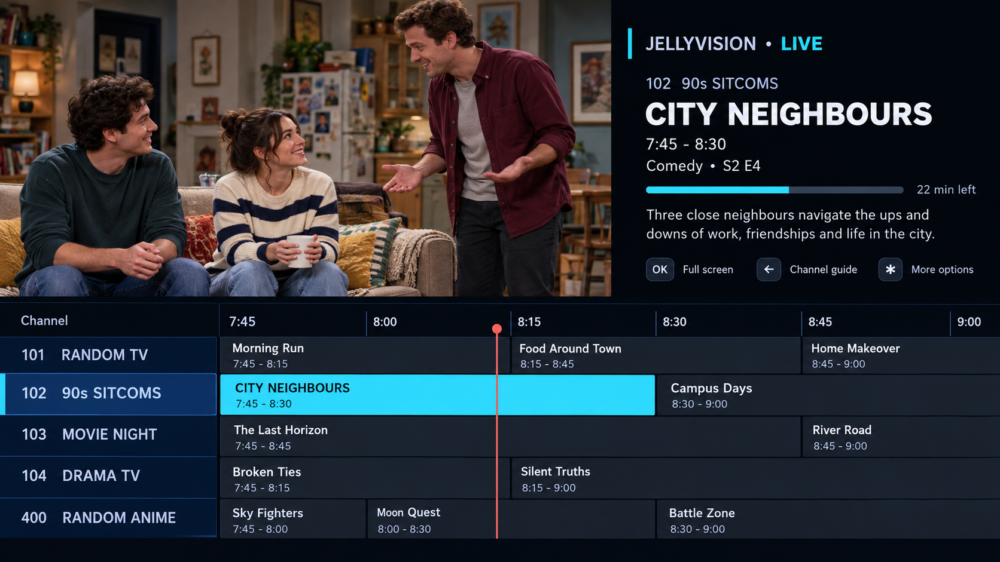

# JellyVision for Roku

> **AI project notice:** JellyVision is a vibe-coded project created with
> ChatGPT. AI was used to help design and write the app, so the code may contain
> mistakes or unexpected behaviour. Please treat it as early test software and
> report any problems you find.

<p align="center">
  
</p>

JellyVision makes your Jellyfin collection feel like ordinary television. It
creates channels for TV shows, movies, animation, anime, comedy, drama and more.
Choose a channel and watch whatever is on, already playing from the correct
point in the programme.

Your videos stay on your own Jellyfin server. JellyVision simply organises and
plays them in a familiar TV guide.

## Interface preview



*Representative preview using fictional programmes. The videos, programme names
and channel contents shown on your TV come from your own Jellyfin library.*

> **Please note:** JellyVision is currently a test version and is not yet in the
> Roku Streaming Store. For now, it must be added to a Roku manually.

## How to add JellyVision to your Roku

You need a Roku TV or Roku player, a computer or phone on the same Wi-Fi network,
and access to your Jellyfin server. The steps below only need to be completed
once.

### 1. Download JellyVision

1. Sign in to GitHub and open the [JellyVision builds](https://github.com/alanoctua/jellyvision/actions/workflows/test.yml) page.
2. Open the newest build that has a green tick beside it.
3. Scroll to **Artifacts** at the bottom of the page.
4. Download the file whose name starts with **JellyVision-Roku-dev**.
5. Keep the downloaded `.zip` file as it is. Do not unzip it.

### 2. Allow test apps on your Roku

1. With the Roku remote, press **Home** three times, **Up** twice, then
   **Right, Left, Right, Left, Right**.
2. The Developer Settings screen will appear. Write down the web address shown
   on the screen. It will look similar to `http://192.168.1.20`.
3. Choose **Enable installer and restart**.
4. Read and accept Roku's agreement, then create a password. Remember this
   password because you will need it in the next step.
5. Let the Roku restart.

### 3. Send JellyVision to the Roku

1. On your computer or phone, open a web browser and enter the Roku web address
   you wrote down.
2. If asked to sign in, use `rokudev` as the username and the password you just
   created.
3. Select **Upload**, choose the JellyVision `.zip` file, then select **Install**.
4. JellyVision should open on the TV when installation finishes. It will also
   appear at the bottom of the Roku home screen.

Roku only allows one manually added test app at a time. Adding another test app
later will replace JellyVision. See [Roku's official instructions](https://developer.roku.com/dev/docs/developer-setup)
if the installer screen does not appear.

### 4. Connect Jellyfin

1. Open JellyVision and enter your Jellyfin server address, including
   `http://` or `https://`. For example: `http://192.168.1.10:8096`.
2. Sign in with your Jellyfin username and password, or use Quick Connect.
3. JellyVision will start a comedy preview when it can, then continue finding
   and organising the rest of your library. You can see its progress at the
   bottom of the screen.
4. When the channel guide is ready, move up or down and press **OK** to choose a
   channel. Press `*` to switch between the guide and full-screen video.

## What JellyVision does today

- Connects directly to your Jellyfin server and remembers your sign-in.
- Starts playing a comedy preview while it prepares the full channel guide.
- Searches your entire library, even when it contains thousands of items.
- Creates 34 channels for different kinds of programmes and films.
- Keeps regular TV, movies, animation, anime series and anime films separate.
- Makes each channel show content that matches its name. An empty channel stays
  empty instead of being filled with unrelated programmes.
- Shows a two-hour TV guide with programme boxes that match their real start and
  finish times.
- Lets you change channels with the guide, channel buttons and supported number
  buttons on the remote.
- Includes Ghost Mode, which is on by default. It stops channel surfing from
  filling Jellyfin's Recently Played and Next Up lists or changing watch progress.

## Architecture

```text
ChannelEngine (Task)
  quick strict comedy preview -> paginated full-library scan
  -> classify once -> build all 34 permanent channels
            |
            v
ScheduleEngine (pure functions)
  stable item ordering + epoch schedule + current playback offset
            |
            v
ChannelGuide / CableFinPlayerOverlay / CableFinChannelRow
  startup state + watch-first programme panel + scrolling guide window
            |
            v
ChannelPlayer
  live schedule window -> official QueueManager -> official VideoPlayerView
```

The boundaries preserve a clean path for editable custom channels, channel
logos, richer overlays, surfing animations, favourites, and persisted schedule
snapshots. The current schedule stays stable while a channel's matching item IDs
and durations remain unchanged.

## Build

Requirements are the same as the upstream app: Node.js, npm, and a Roku in
developer mode.

```sh
npm ci
npm run build
```

The compiled sideload tree is written to `build/staging`; a packaged zip is
written to `out`. The upstream VS Code launch configuration can also deploy to a
Roku after its IP address and developer password are configured.

The original JellyVision artwork is preserved in `artwork`. Roku-ready splash
screens and home-screen posters are generated in `images` at the dimensions
referenced by the manifest.

## First run and controls

1. Enter the Jellyfin server URL, including `http://` or `https://` when needed.
2. Sign in with a Jellyfin user or Quick Connect.
3. JellyVision makes a small comedy-series request first. If a live-action match is
   available, the temporary channel `000 Comedy Preview` starts at the correct
   pseudo-live offset.
4. The complete Jellyfin scan continues while the preview plays. Its current
   phase, item count, and progress bar appear above the guide at the bottom.
5. When all 34 permanent channels are ready, they replace the preview in the
   guide. The preview keeps playing until you choose a permanent channel, so a
   programme is never interrupted merely because loading finished.
6. Press up/down to browse the visible guide and OK to tune. Use a supported
   number pad to enter a three-digit channel number such as `401`.
7. Press `*` for full-screen video; press Back to restore the guide, then Back
   again to leave playback.
8. On the main JellyVision guide, press `*` to open the side menu and switch Ghost
   Mode on or off. The same option is available under Settings / JellyVision.

## Current limits

- Channel rules are built in and strictly combine Jellyfin media type, genres,
  tags, year, and exclusions. Series genres and tags are inherited by episodes
  before classification. JellyVision never substitutes unrelated library content
  when a rule has no matches.
- The startup preview is also strict: it requires a comedy or sitcom series and
  excludes anime and animation. If no suitable series is found quickly, the app
  shows the normal loading screen rather than playing unrelated content.
- All available movies, episodes, and television series are retrieved in
  500-item pages. Channel schedules are no longer capped at 240 items.
- Numeric buttons are not part of Roku's guaranteed SceneGraph key set, so the
  app supports common digit key names but availability depends on the remote and
  Roku firmware.
- The playback queue is prepared 12 programmes ahead. A later milestone can
  extend it indefinitely and resynchronise after long pauses.
- Ghost Mode cannot hide authentication, library, playback-information,
  transcoding, or media-stream requests because those are required to play the
  file. It suppresses only the activity reports that update Jellyfin user
  history.
- Adding or removing matching media changes deterministic ordering. Persisted
  schedule snapshots remain a future feature.

## Channel lineup and matching rules

The matching pass separates content by Jellyfin item type and genre or tag
values. `Anime` is treated as its own required classification; JellyVision also
recognises a Jellyfin library or media-path folder containing the word `Anime`,
as well as tags such as `Anime Series`. Ordinary animation is excluded from
live-action channels.
Within each content family, competing genre channels are exclusive with one
another. Anime genre and decade channels use separate lanes so both kinds remain
populated. The three overview channels intentionally include their whole content
family.

| Channel | Name | Selection rule |
| --- | --- | --- |
| 101 | Random TV | Every live-action episode; excludes anime and animation |
| 102 | 90s Sitcoms | Comedy or sitcom episodes, 1988–1999; excludes anime and animation |
| 103 | Movie Night | Every live-action movie; excludes anime and animation |
| 104 | Drama TV | Drama episodes; excludes anime and animation |
| 105 | Kids & Family TV | Family, children, or kids episodes; excludes anime and animation |
| 106 | Animated TV | Animation episodes; excludes anime |
| 107 | Documentary TV | Documentary episodes; excludes anime and animation |
| 108 | Comedy TV | Comedy or sitcom episodes not assigned to 102; excludes anime and animation |
| 109 | Crime & Mystery TV | Crime or mystery episodes; excludes anime and animation |
| 110 | Action & Adventure TV | Action or adventure episodes; excludes anime and animation |
| 111 | Sci-Fi & Fantasy TV | Science fiction, sci-fi, sci fi, or fantasy episodes; excludes anime and animation |
| 112 | Horror & Thriller TV | Horror or thriller episodes; excludes anime and animation |
| 201 | Kids & Family Movies | Family, children, or kids movies; excludes anime and animation |
| 202 | Animated Movies | Animation movies; excludes anime |
| 203 | Documentary & History | Documentary, history, or biography movies; excludes anime and animation |
| 204 | Horror Movies | Horror movies; excludes anime and animation |
| 205 | Sci-Fi & Fantasy Movies | Science fiction, sci-fi, sci fi, or fantasy movies; excludes anime and animation |
| 206 | Crime, Mystery & Thriller | Crime, mystery, or thriller movies; excludes anime and animation |
| 207 | Action & Adventure Movies | Action or adventure movies; excludes anime and animation |
| 208 | Comedy Movies | Comedy movies; excludes anime and animation |
| 209 | Drama & Romance Movies | Drama or romance movies; excludes anime and animation |
| 210 | War & Westerns | War or western movies; excludes anime and animation |
| 400 | Random Anime | Every anime episode |
| 401 | Comedy Anime | Anime episodes tagged/genre comedy or sitcom |
| 402 | Action Anime | Anime episodes tagged/genre action or adventure |
| 403 | Drama Anime | Anime episodes tagged/genre drama |
| 404 | Feel-Good & Family Anime | Anime episodes tagged/genre feel good, family, kids, slice of life, iyashikei, heartwarming, wholesome, romance, friendship, school, coming of age, or healing |
| 405 | Horror & Thriller Anime | Anime episodes tagged/genre horror or thriller |
| 406 | Classic Anime | Anime episodes released through 1989 |
| 407 | 90s Anime | Anime episodes released 1990–1999 |
| 408 | 2000s Anime | Anime episodes released 2000–2009 |
| 409 | 2010s Anime | Anime episodes released 2010–2019 |
| 410 | Modern Anime | Anime episodes released from 2020 onward |
| 420 | Anime Movies | Movies tagged/genre anime |

## Upstream and licence

This repository is a derivative of
[jellyfin/jellyfin-roku](https://github.com/jellyfin/jellyfin-roku), the official
Jellyfin Roku client. The upstream GPL-2.0 licence is retained in `LICENSE`.
